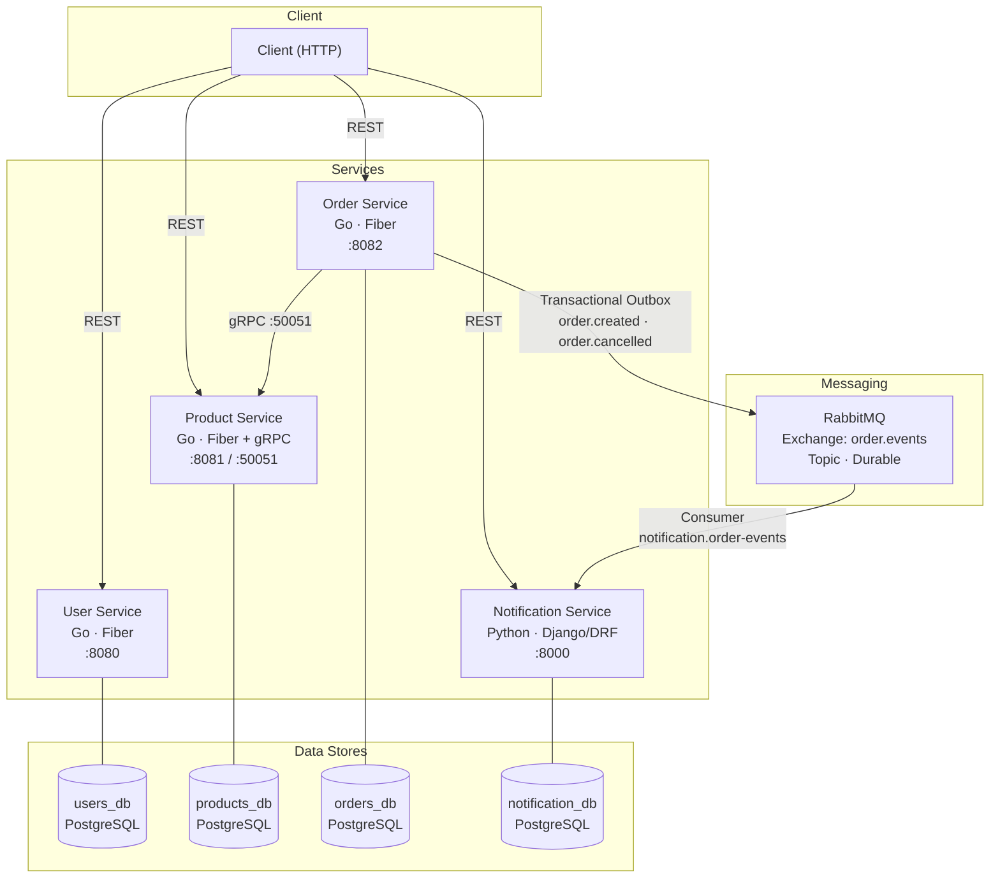
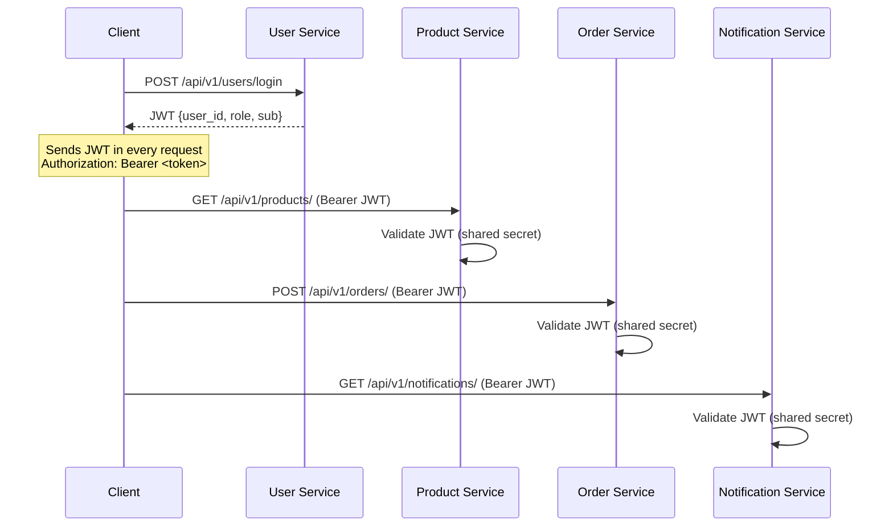

# Go Microservices — E-Commerce Backend

> An educational, production-grade **Microservices** project built with **Go** and **Python (Django)**, designed for Software Engineers learning how to architect, build, and integrate distributed backend systems.

---

## System Architecture



---

## Services Overview

| Service | Language | Framework | Port(s) | Database | Role |
| :--- | :--- | :--- | :--- | :--- | :--- |
| **User Service** | Go | Fiber v2 | `:8080` REST | PostgreSQL | Authentication authority — registers users, issues HMAC-SHA256 JWT tokens |
| **Product Service** | Go | Fiber v2 + gRPC | `:8081` REST · `:50051` gRPC | PostgreSQL | Product catalog — exposes REST API and gRPC server for inter-service calls |
| **Order Service** | Go | Fiber v2 | `:8082` REST | PostgreSQL | Order management — creates/cancels orders, validates products via gRPC, publishes domain events via Transactional Outbox + RabbitMQ |
| **Notification Service** | Python 3.11 | Django 5.2 / DRF 3.18 | `:8000` REST | PostgreSQL | In-App Notification Center — consumes RabbitMQ events, persists notifications, exposes 9 authenticated REST endpoints |

---

## Communication Patterns

### Synchronous (Request-Response)

| Source | Target | Protocol | Purpose |
| :--- | :--- | :--- | :--- |
| Client | All Services | REST / HTTP | CRUD operations, authentication, queries |
| Order Service | Product Service | gRPC (`:50051`) | Product validation, stock check, price snapshot at order creation |

### Asynchronous (Event-Driven)

| Source | Target | Broker | Exchange | Routing Keys |
| :--- | :--- | :--- | :--- | :--- |
| Order Service | Notification Service | RabbitMQ | `order.events` (topic, durable) | `order.created`, `order.cancelled` |

**Flow:** Order Service → PostgreSQL Transactional Outbox → Outbox Dispatcher → RabbitMQ Publisher → `order.events` Exchange → `notification.order-events` Queue → Notification Consumer → In-App Notification Record

---

## Authentication Model



- **User Service** is the **sole JWT issuer** (HMAC-SHA256).
- All other services are **validators only**, using the same shared `JWT_SECRET`.
- JWT claims: `user_id` (integer), `role` (string), `sub` (email string).

---

## Event Contract (Wire Format)

All domain events follow the Go `EventEnvelope[T]` generic structure:

```json
{
  "event_id": "550e8400-e29b-41d4-a716-446655440000",
  "event_type": "order.created",
  "schema_version": 1,
  "occurred_at": "2026-11-15T10:30:00.000000Z",
  "data": {
    "order_id": 150,
    "user_id": 1
  }
}
```

| Event Type | Routing Key | Payload Fields |
| :--- | :--- | :--- |
| `order.created` | `order.created` | `order_id` (uint64), `user_id` (uint) |
| `order.cancelled` | `order.cancelled` | `order_id` (uint64), `user_id` (uint), `reason` (string) |

---

## Internal Architecture (Shared Pattern)

All Go services follow the same layered architecture:

```
main.go
  ├── config/          Load environment variables, build Config struct
  ├── repository/      Database layer (GORM) — only layer that touches SQL
  ├── service/         Business logic — no HTTP, no SQL
  ├── handler/         Translate HTTP ↔ service calls
  └── api/server       HTTP server, route registration, graceful shutdown
```

The Notification Service (Django) follows a parallel pattern:

```
manage.py
  ├── config/          Django settings, URL routing
  ├── notifications/
  │   ├── models.py          Database layer (Django ORM)
  │   ├── services.py        Business logic — event processing, notification creation
  │   ├── views.py           REST API — DRF ViewSet with 9 operations
  │   ├── serializers.py     Request/response serialization
  │   ├── authentication.py  JWT validation (matches Go TokenHelper)
  │   └── consumers/         RabbitMQ event consumer (management command)
  └── docs/                  Detailed documentation
```

---

## Technology Stack

| Technology | Purpose |
| :--- | :--- |
| **Go** | Primary backend language (3 services) |
| **Python 3.11** | Notification Service runtime |
| **Fiber v2** | Go HTTP framework |
| **Django 5.2 / DRF 3.18** | Python HTTP framework / REST API |
| **gRPC + Protocol Buffers** | Synchronous inter-service communication |
| **GORM** | Go ORM for PostgreSQL |
| **Django ORM** | Python ORM for PostgreSQL |
| **PostgreSQL** | Relational database (one per service, 4 total) |
| **RabbitMQ** | Asynchronous message broker (AMQP 0-9-1) |
| **JWT (HMAC-SHA256)** | Stateless authentication (shared secret) |
| **bcrypt** | Password hashing (User Service) |
| **Pika** | Python AMQP client for RabbitMQ |
| **PyJWT** | Python JWT validation library |
| **Pytest** | Python test framework |

---

## Reliability & Data Integrity

### Transactional Outbox Pattern (Order Service)

The Order Service guarantees **at-least-once event delivery** using the Transactional Outbox pattern:

1. Order + OrderItems + OutboxEvent are committed in a **single PostgreSQL transaction**.
2. A background **Outbox Dispatcher** polls for unpublished events.
3. The **RabbitMQ Publisher** publishes with Publisher Confirms, ACK/NACK handling, and mandatory routing.
4. Only after RabbitMQ confirms receipt is the outbox event marked as published.

### Idempotent Consumer (Notification Service)

The Notification Service prevents duplicate notifications during redeliveries:

1. Each event carries a unique `event_id` (UUID).
2. `ProcessedEvent` model with a **database-level unique constraint** on `event_id`.
3. Registering processed event + creating notification happens inside **one PostgreSQL transaction**.
4. If a duplicate `event_id` arrives → `IntegrityError` → event is ACKed (already processed), no duplicate notification.

### Dead Letter Queue

Permanently invalid messages (bad JSON, unsupported event types, schema version mismatches) are rejected to a Dead Letter Queue after bounded retries, preventing infinite requeue loops.

---

## Running the Project

### Prerequisites

- Go 1.21+
- Python 3.11+
- PostgreSQL 16+
- RabbitMQ 3.x
- Protocol Buffers compiler (`protoc`) — for gRPC code generation

### Starting All Services

```bash
# Terminal 1 — User Service (REST :8080)
cd user_service
cp .env.example .env     # Configure DB credentials
go run main.go

# Terminal 2 — Product Service (REST :8081, gRPC :50051)
cd product_service
cp .env.example .env
go run main.go

# Terminal 3 — Order Service (REST :8082)
cd order_service
cp .env.example .env     # Set PRODUCT_SERVICE_GRPC_ADDR=127.0.0.1:50051
go run main.go

# Terminal 4 — Notification Service REST API (:8000)
cd notification_service
./bin/python manage.py migrate
./bin/python manage.py runserver 0.0.0.0:8000

# Terminal 5 — Notification Service RabbitMQ Consumer
cd notification_service
./bin/python manage.py consume_order_events
```

Each service requires its own PostgreSQL database. See `.env.example` files in each service directory.

---

## What Has Been Built

- [x] REST APIs with Fiber (Go services) and Django REST Framework (Notification Service)
- [x] Layered Architecture — Handler → Service → Repository (all services)
- [x] JWT authentication shared across all four services
- [x] GORM with PostgreSQL and AutoMigrate (Go services)
- [x] Django ORM with PostgreSQL migrations (Notification Service)
- [x] gRPC Server in Product Service + gRPC Client in Order Service
- [x] Product validation, stock check, and price snapshot via gRPC at order creation
- [x] Atomic database transactions for order creation
- [x] Transactional Outbox Pattern for reliable event publishing
- [x] RabbitMQ Publisher with Publisher Confirms, ACK/NACK, mandatory routing
- [x] Outbox Dispatcher background worker
- [x] RabbitMQ Consumer with bounded retries and Dead Letter Queue
- [x] Idempotent event processing with database-level unique constraints
- [x] Atomic notification creation + processed event registration
- [x] 9 authenticated REST endpoints for notification management
- [x] Cross-user data isolation enforced via JWT claims
- [x] Graceful shutdown (HTTP servers, DB pools, gRPC connections, RabbitMQ consumers)
- [x] Unit and integration tests (Go + Python/Pytest)
- [x] Comprehensive English documentation

---

## Learning Roadmap (Planned)

- [ ] Docker + Docker Compose (run all services with one command)
- [ ] API Gateway / Reverse Proxy (Nginx or Traefik)
- [ ] Distributed Tracing (Jaeger or OpenTelemetry)
- [ ] CI/CD Pipeline (GitHub Actions)
- [ ] Kubernetes deployment manifests

---

## Documentation

### Project-Wide

| Document | Description |
| :--- | :--- |
| [Project Architecture](notification_service/docs/project-architecture.md) | This document — full system overview |

### User Service

| Document | Description |
| :--- | :--- |
| [User Service Documentation](user_service/docs/user_service.md) | Complete REST API, JWT issuance, user CRUD |

### Product Service

| Document | Description |
| :--- | :--- |
| [Product Service Documentation](product_service/docs/product_service.md) | REST API, gRPC server, product catalog |

### Order Service

| Document | Description |
| :--- | :--- |
| [Order Service Documentation](order_service/docs/order_service.md) | Complete REST API, order lifecycle |
| [Order Service Analysis](order_service/docs/order-service-analysis.md) | Technical analysis and design decisions |
| [What We Built](order_service/docs/what-we-built.md) | Engineering walkthrough of all components |

### Notification Service

| Document | Description |
| :--- | :--- |
| [Notification Service README](notification_service/README.md) | Service overview, quick start, API summary |
| [Architecture & Design Decisions](notification_service/docs/architecture.md) | Service architecture and design rationale |
| [REST API Specification](notification_service/docs/api.md) | All 9 endpoints with examples |
| [Event Contracts & Wire JSON](notification_service/docs/event-contract.md) | Go EventEnvelope contract and JSON examples |
| [Database Schema & Indexes](notification_service/docs/database.md) | Models, indexes, and idempotency design |
| [RabbitMQ Topology & Reliability](notification_service/docs/rabbitmq.md) | Queue bindings, DLQ, consumer reliability |
| [JWT Authentication](notification_service/docs/authentication.md) | JWT validation and user ownership model |
| [Development & Operations](notification_service/docs/development.md) | Setup, testing, and operational guide |

---

## Repository Structure

```
go-service/
├── README.md                           ← Root project documentation
├── .gitignore                          ← Global git ignore rules
│
├── user_service/                       ← Go · Authentication & JWT Issuance
│   ├── main.go
│   ├── config/
│   ├── internal/
│   │   ├── auth/jwt.go                 ← JWT generation (HMAC-SHA256)
│   │   ├── domain/
│   │   ├── dto/
│   │   ├── repository/
│   │   ├── service/
│   │   ├── helper/
│   │   └── api/
│   └── docs/user_service.md
│
├── product_service/                    ← Go · Product Catalog (REST + gRPC)
│   ├── main.go
│   ├── config/
│   ├── internal/
│   │   ├── api/grpc/                   ← gRPC Server implementation
│   │   ├── api/rest/
│   │   ├── entiti/
│   │   ├── dto/
│   │   ├── repostory/
│   │   └── service/
│   ├── proto/product/v1/               ← Protocol Buffers definition
│   └── docs/product_service.md
│
├── order_service/                      ← Go · Order Management + Event Publishing
│   ├── main.go
│   ├── config/
│   ├── internal/
│   │   ├── entity/
│   │   │   ├── order.go                ← Order + OrderItem models
│   │   │   └── outbox.go              ← Transactional Outbox model
│   │   ├── events/
│   │   │   └── order_created.go        ← EventEnvelope[T], OrderCreated/Cancelled payloads
│   │   ├── repository/
│   │   ├── service/
│   │   ├── client/
│   │   │   └── product_grpc_client.go  ← gRPC client to Product Service
│   │   ├── messaging/
│   │   │   ├── rabbitmq/
│   │   │   │   ├── connection.go       ← AMQP connection with reconnect
│   │   │   │   └── publisher.go        ← Publisher with Confirms + mandatory routing
│   │   │   └── outbox/
│   │   │       └── dispatcher.go       ← Background Outbox Dispatcher
│   │   └── api/
│   ├── proto/product/v1/
│   └── docs/
│
├── notification_service/               ← Python/Django · In-App Notification Center
│   ├── manage.py
│   ├── requirements.txt
│   ├── .env
│   ├── config/                         ← Django settings + URL routing
│   ├── notifications/
│   │   ├── models.py                   ← Notification + ProcessedEvent models
│   │   ├── services.py                 ← Event processing + notification creation
│   │   ├── views.py                    ← 9 REST API operations (DRF ViewSet)
│   │   ├── serializers.py              ← DRF serializers
│   │   ├── authentication.py           ← JWT validation (Go-compatible)
│   │   ├── urls.py                     ← API URL routing
│   │   └── consumers/
│   │       └── order_consumer.py       ← RabbitMQ consumer (management command)
│   ├── tests/
│   │   ├── test_api.py                 ← 18 API + auth tests
│   │   └── test_services.py            ← 11 service + idempotency tests
│   └── docs/                           ← 7 detailed documentation files
│       ├── architecture.md
│       ├── api.md
│       ├── event-contract.md
│       ├── database.md
│       ├── rabbitmq.md
│       ├── authentication.md
│       └── development.md
```

---

## License

Educational project — built for learning purposes.
