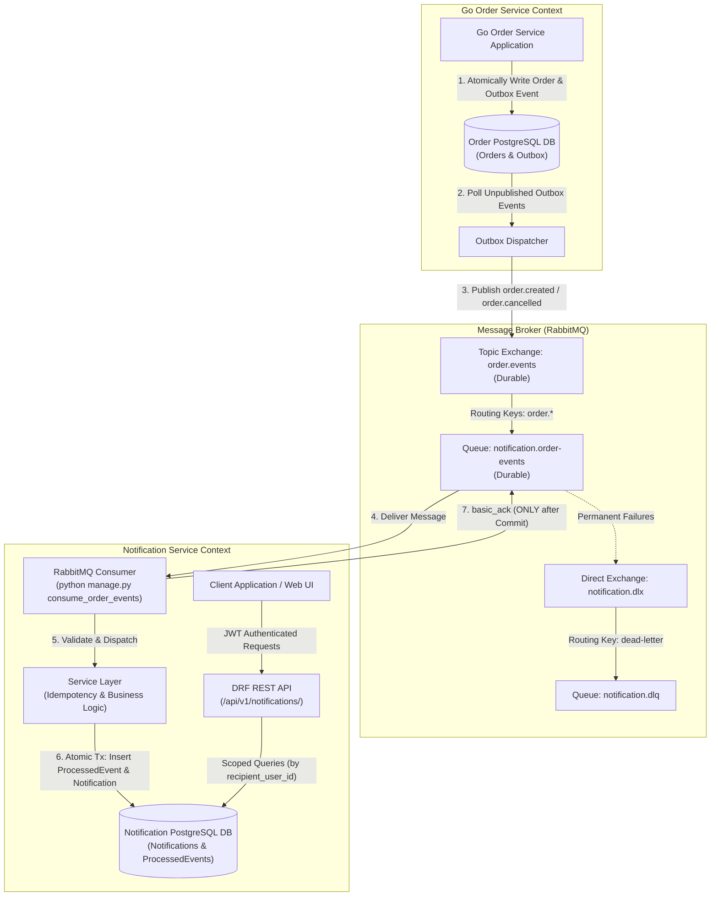
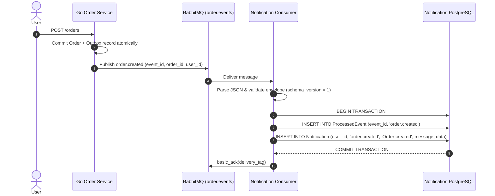
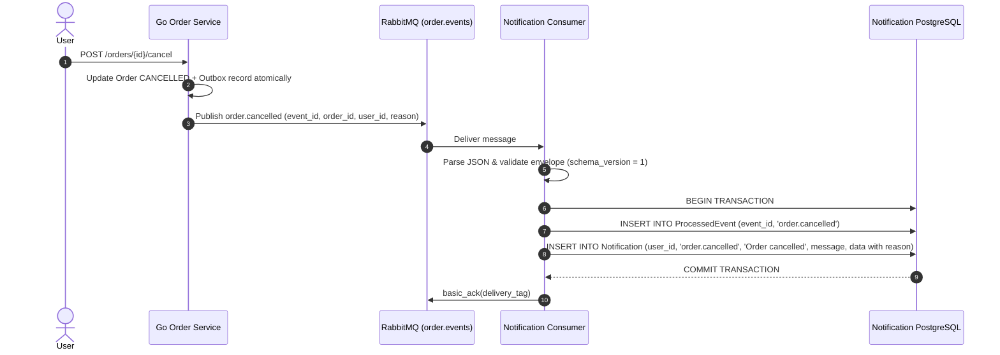

# Notification Service Architecture

## 1. System Overview

The **Notification Service** is an independent, asynchronous microservice responsible for managing persistent in-app notifications. It integrates with the Go-based **Order Service** via asynchronous event streaming over **RabbitMQ**, operating completely decoupled from the Order Service's application runtime and database.

---

## 2. Key Architectural Decisions

### A. Separation of Background Consumer and HTTP REST API
- **Different Concurrency Profiles:** The RabbitMQ Consumer (`python manage.py consume_order_events`) maintains a long-running, blocking TCP socket with RabbitMQ. Running this inside synchronous web workers (e.g. Gunicorn/uWSGI) blocks HTTP request threads.
- **Independent Scaling:** Ingress event consumption scales based on order creation rate, while HTTP API scales with user active sessions and notification reading patterns.
- **Fault Isolation:** A consumer crash due to an unhandled broker disconnection or poison message never compromises the HTTP availability of the REST API.

### B. Microservice & Database Independence (Bounded Contexts)
- The Notification Service maintains its own PostgreSQL database.
- It **never** queries or establishes SQL connections to the Order Service database or User Service database.
- Recipient identity (`recipient_user_id`) is stored as an unconstrained scalar integer. Relational integrity is preserved at the event-contract level, avoiding distributed database deadlocks.

### C. Transactional Idempotency via Database Constraints
- In distributed systems, RabbitMQ guarantees **at-least-once delivery**. Transient network partitions or worker restarts can cause identical events to be delivered multiple times.
- Application-level deduplication (`if exists(...)`) suffers from concurrency race conditions.
- Idempotency is enforced by inserting the event's `event_id` into the `ProcessedEvent` table, which features a database-level `PRIMARY KEY` (unique constraint). If an `IntegrityError` occurs, the event is recognized as a duplicate and skipped safely without generating a second notification.

### D. Manual Broker Acknowledgment (ACK)
- Messages are acknowledged (`ch.basic_ack()`) **strictly after** the database transaction (`transaction.atomic`) commits.
- If the database is temporarily unreachable, the transaction fails and the consumer issues a `basic_nack(requeue=True)` with bounded retry backoff.
- If a message contains invalid JSON, missing fields, or an unsupported schema version, it is rejected without requeuing (`basic_reject(requeue=False)`), routing it to the Dead Letter Queue (`notification.dlq`).

---

## 3. End-to-End Event Processing Flows

### A. OrderCreated Event Flow (`order.created`)

When a customer successfully places an order in the Go Order Service:

1. **Publication:** The Go Outbox Dispatcher publishes `order.created` with payload containing `order_id` and `user_id`.
2. **Consumption:** The Consumer receives the AMQP frame and validates envelope headers.
3. **Notification Generation:** 
   - Title: `Order created`
   - Message: `Your order #<order_id> has been created successfully.`
   - Structured JSON: `{"order_id": <order_id>, "user_id": <user_id>}`.
4. **Persistence & ACK:** Atomically committed into PostgreSQL; message acknowledged.

---

### B. OrderCancelled Event Flow (`order.cancelled`)

When an order is cancelled in the Go Order Service:

1. **Publication:** The Go Outbox Dispatcher publishes `order.cancelled` with payload containing `order_id`, `user_id`, and `reason` (e.g. `"User requested cancellation"`).
2. **Consumption:** The Consumer parses the payload.
3. **Notification Generation:**
   - Title: `Order cancelled`
   - Message: `Your order #<order_id> has been cancelled.`
   - Structured JSON: `{"order_id": <order_id>, "user_id": <user_id>, "reason": "User requested cancellation"}`.
4. **Persistence & ACK:** The exact cancellation reason is preserved in the notification's structured JSON data. Atomically committed and message ACKed.
