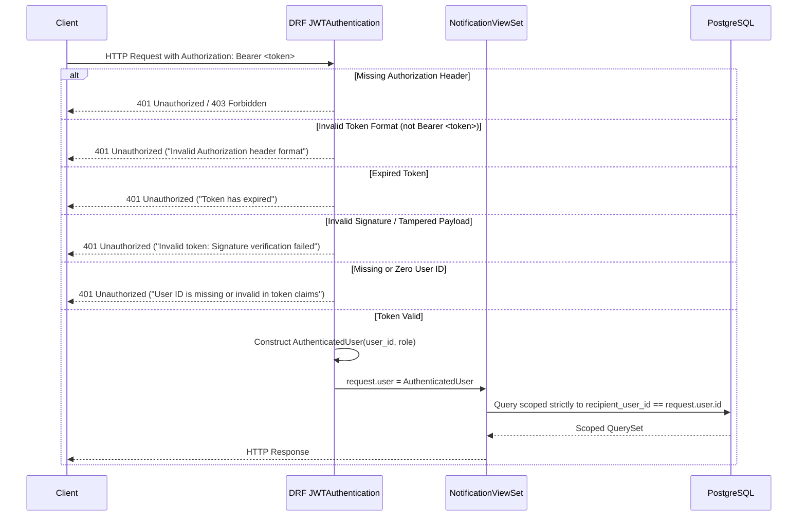

# Authentication & User Ownership Architecture

The Notification Service implements stateless JSON Web Token (JWT) authentication, fully compatible with tokens issued by the Go Order Service and User Service.

---

## 1. Go Token Contract Compatibility

The authentication implementation (`notifications/authentication.py`) mirrors the Go Token Helper contract defined in `order_service/internal/helper/token.go`:

### Token Characteristics:
- **Algorithm:** HMAC SHA-256 (`HS256`).
- **Signature Secret:** Configured via `JWT_SECRET_KEY` environment variable.
- **Header Format:** Standard HTTP Authorization Bearer token:
  ```http
  Authorization: Bearer <base64_encoded_jwt_token>
  ```

### Claims Mapping:
| Claim Name | Type | Priority | Description |
| :--- | :--- | :--- | :--- |
| `user_id` | integer (unsigned) | Primary | Customer user identifier. |
| `id` | integer (unsigned) | Secondary Fallback | Legacy / alternate user ID field. |
| `sub` | string (numeric) | Tertiary Fallback | Standard JWT subject claim. |
| `role` | string | Standard | User role (e.g., `user`, `admin`). Defaults to `user`. |
| `exp` | integer (timestamp) | Mandatory | Unix epoch timestamp of token expiration. |

---

## 2. Authentication Flow & Error Handling



---

## 3. Strict User Ownership Isolation (Multi-Tenancy)

In multi-tenant microservices, user identity must never be trusted from client input.

### Security Rules:
1. **No Client-Supplied User IDs:** The API never reads `user_id` from request bodies, path variables, or query parameters.
2. **Cryptographic Derivation:** `recipient_user_id` is derived solely from the cryptographically verified JWT payload (`request.user.id`).
3. **ORM Scoping:** Every query executed in `NotificationViewSet` is filtered at the database level:
   ```python
   Notification.objects.filter(recipient_user_id=request.user.id)
   ```
4. **Access Prevention:** If User A attempts to view, update, or delete a notification belonging to User B:
   - The query returns an empty set.
   - DRF responds with `404 Not Found` (rather than `403 Forbidden`) to avoid leaking the existence of other users' notification IDs.
