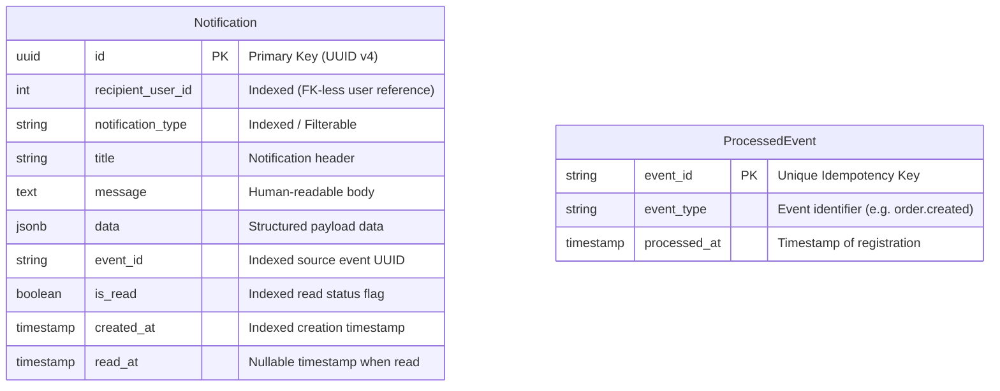
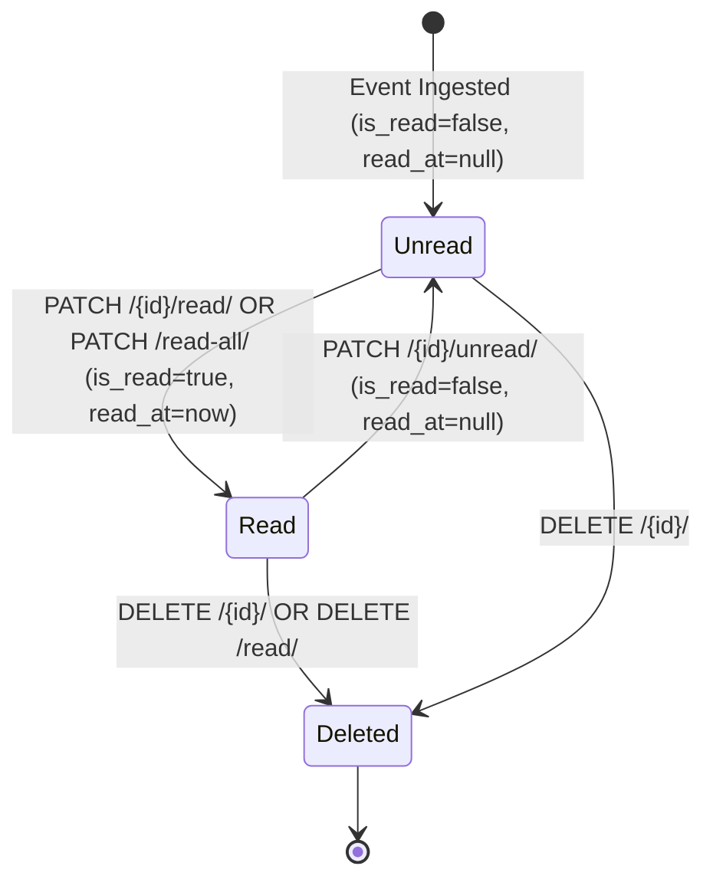

# Database Architecture & Data Models

The Notification Service maintains an autonomous PostgreSQL database (`notification_db`) to store user notifications and processed event logs. It never connects directly to the Go Order Service database.

---

## 1. Entity Relationship (ER) Diagram



---

## 2. Models Specification

### A. Notification Model (`notifications/models.py`)

Stores individual in-app notification records presented to users in the Notification Center.

| Column | PostgreSQL Type | Constraints / Defaults | Description |
| :--- | :--- | :--- | :--- |
| `id` | `uuid` | `PRIMARY KEY`, Default: `uuid.uuid4` | Unique notification identifier. |
| `recipient_user_id` | `integer` (unsigned) | `NOT NULL`, `db_index=True` | ID of the recipient user (derived from JWT / Go event). |
| `notification_type` | `varchar(50)` | `NOT NULL` | Business type (e.g., `order.created`, `order.cancelled`). |
| `title` | `varchar(255)` | `NOT NULL` | Brief title header for the notification. |
| `message` | `text` | `NOT NULL` | Full descriptive message text. |
| `data` | `jsonb` | `NOT NULL`, Default: `{}` | Structured JSON metadata (e.g., `order_id`, `reason`). |
| `event_id` | `varchar(100)` | `NULL`, `db_index=True` | Originating RabbitMQ `event_id` for traceability. |
| `is_read` | `boolean` | `NOT NULL`, Default: `FALSE`, `db_index=True` | Read status indicator. |
| `created_at` | `timestamp with tz` | `NOT NULL`, `auto_now_add=True`, `db_index=True` | Timestamp when notification was created. |
| `read_at` | `timestamp with tz` | `NULL` | Timestamp when notification was marked as read. |

#### Database Indexes & Performance Optimization:
1. `notif_user_read_idx`: Composite index on `(recipient_user_id, is_read)`.
   - Optimizes unread queries: `SELECT COUNT(*) FROM notifications WHERE recipient_user_id = %s AND is_read = FALSE;`
2. `notif_user_created_idx`: Composite index on `(recipient_user_id, -created_at)`.
   - Optimizes default sorted pagination: `SELECT * FROM notifications WHERE recipient_user_id = %s ORDER BY created_at DESC LIMIT 20;`
3. Single indexes on `id`, `recipient_user_id`, `is_read`, `created_at`, `event_id`.

---

### B. ProcessedEvent Model (`notifications/models.py`)

Maintains an immutable record of consumed events to enforce message deduplication and idempotency.

| Column | PostgreSQL Type | Constraints / Defaults | Description |
| :--- | :--- | :--- | :--- |
| `event_id` | `varchar(100)` | `PRIMARY KEY`, `UNIQUE` | Originating UUID from RabbitMQ event envelope. |
| `event_type` | `varchar(50)` | `NOT NULL` | Name of the event (`order.created`, `order.cancelled`). |
| `processed_at` | `timestamp with tz` | `NOT NULL`, `auto_now_add=True` | Timestamp when event was committed. |

---

## 3. Idempotency & Transaction Boundaries

### Why Database Constraints are the Ultimate Authority:
In high-throughput microservice systems, duplicate messages arrive concurrently. An application check like:
```python
if ProcessedEvent.objects.filter(event_id=event_id).exists():
    return
```
suffers from a race window: two consumer threads can both evaluate `exists() == False` and both insert duplicate notifications.

By defining `event_id` as the **PRIMARY KEY** of `ProcessedEvent`, PostgreSQL's B-Tree unique constraint performs an atomic hardware-level check. Any subsequent insertion attempt immediately throws `IntegrityError`.

### Atomic Transaction Scope (`transaction.atomic()`):
```python
with transaction.atomic():
    # 1. Attempt insertion into ProcessedEvent
    ProcessedEvent.objects.create(event_id=event_id, event_type=event_type)

    # 2. Persist the Notification
    create_notification(...)
```

- If notification creation encounters an unexpected failure, the `ProcessedEvent` record is automatically rolled back, allowing RabbitMQ to retry.
- If a duplicate message arrives, the `IntegrityError` is caught, the transaction rolls back cleanly, and the consumer ACKs the message without creating a duplicate notification.

---

## 4. Read / Unread State Lifecycle



- When a notification is generated, `is_read` defaults to `False` and `read_at` is `None`.
- Marking as read sets `is_read = True` and populates `read_at` with UTC timestamp.
- Marking as unread clears `read_at = None` and resets `is_read = False`.
- Bulk operations (`/read-all/` and `/read/`) execute via database-level `UPDATE` and `DELETE` queries, never loading records into Python memory.
