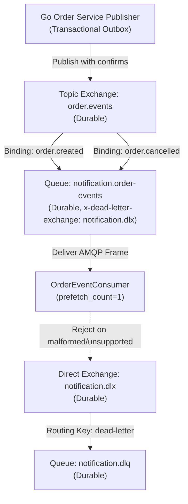

# RabbitMQ Messaging Architecture & Consumer Operations

The Notification Service integrates with RabbitMQ to asynchronously receive order lifecycle events published by the Go Order Service outbox dispatcher.

---

## 1. RabbitMQ Topology



### Topology Components:
| Entity Name | Type | Durability | Properties / Bindings |
| :--- | :--- | :--- | :--- |
| `order.events` | Topic Exchange | Durable | Published by Go Order Service. |
| `notification.order-events` | Queue | Durable | Bound to `order.created` and `order.cancelled`. Configured with `x-dead-letter-exchange: notification.dlx`, `x-dead-letter-routing-key: dead-letter`. |
| `notification.dlx` | Direct Exchange | Durable | Collects unprocessable / poisoned messages. |
| `notification.dlq` | Queue | Durable | Bound to `notification.dlx` with routing key `dead-letter`. |

---

## 2. Consumer Execution & Reliability

The RabbitMQ consumer runs as an independent, persistent process via Django management command:
```bash
python manage.py consume_order_events
```

### Key Engineering Principles:

#### 1. Manual Acknowledgment (ACK)
- `auto_ack = False`: The consumer explicitly acknowledges messages using `ch.basic_ack(delivery_tag)`.
- **Timing:** ACK is sent **strictly after** the database transaction (`transaction.atomic`) commits. If the process crashes or loses power before commit, RabbitMQ automatically redelivers the message to another consumer.

#### 2. Fair Dispatch (Prefetch Count = 1)
- `ch.basic_qos(prefetch_count=1)` ensures RabbitMQ sends only 1 unacknowledged message to a worker at a time. This prevents a single consumer process from buffering messages in memory, ensuring optimal load distribution across multiple consumer replicas.

#### 3. Dead Letter Queue (DLQ) & Permanent Failures
When a message cannot be processed due to permanent data errors:
- Malformed JSON body
- Missing envelope fields (`event_id`, `event_type`, `data`)
- Unsupported `schema_version` (must be `1`)
- Unsupported `event_type`
The consumer rejects the message without requeue:
```python
ch.basic_reject(delivery_tag=delivery_tag, requeue=False)
```
RabbitMQ automatically redirects rejected messages to `notification.dlq` for operator inspection, preventing poison-pill deadlocks.

#### 4. Bounded Retries & Transient Failures
- If a transient failure occurs (e.g. database network disconnect):
  - Immediate tight looping is prevented by checking `method.redelivered` or headers retry counts.
  - After exceeding maximum retries (`MAX_RETRIES = 3`), the message is rejected to DLQ.
  - Otherwise, a backoff delay (`time.sleep(1)`) occurs before calling `ch.basic_nack(requeue=True)`.

#### 5. Graceful Shutdown & Reconnection
- The consumer listens for OS signals `SIGINT` and `SIGTERM`.
- When terminated, it cleanly drains active messages, cancels consumers (`channel.stop_consuming()`), and closes AMQP channels and TCP connections.
- If RabbitMQ temporarily disconnects, the consumer executes an exponential reconnect loop every 5 seconds until connection is restored.
