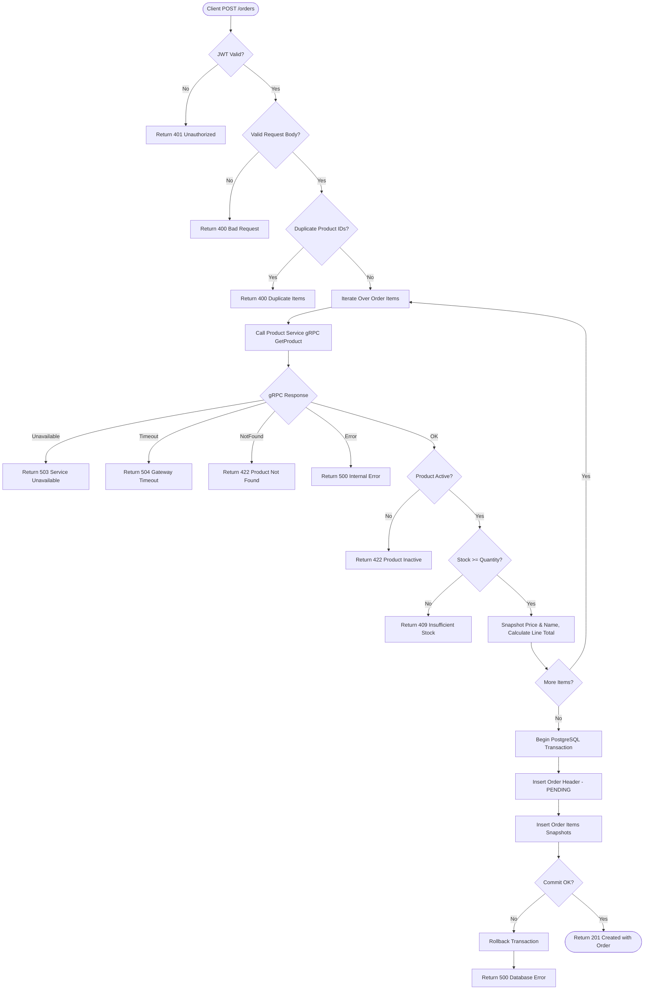
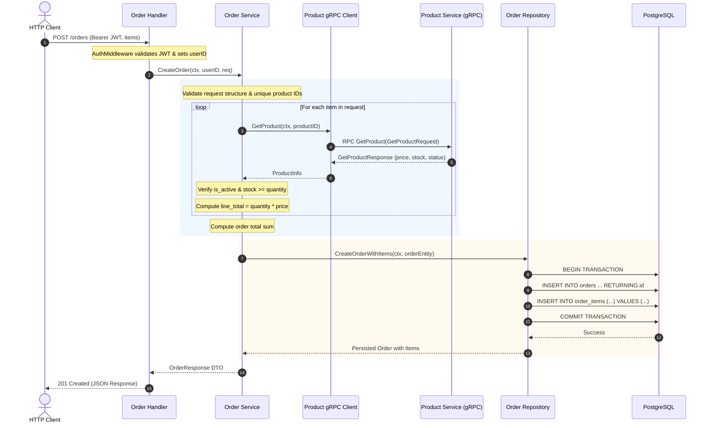
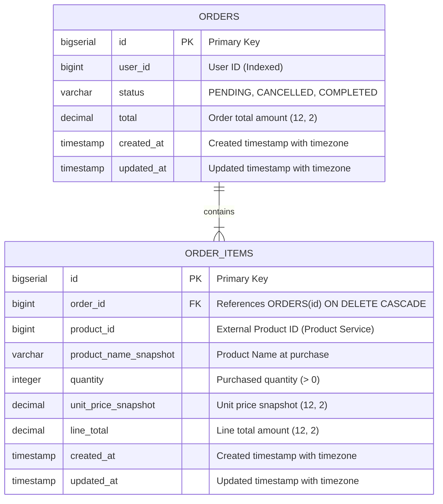

# Order Service – Analysis & Design Document (MVP 1.0)

## 1. Goal and Scope

### 1.1 Goal
The primary objective of the **Order Service** is to provide the initial MVP for managing orders in an e-commerce microservices architecture. It allows authenticated users to:
1. Place orders for one or more products.
2. View a paginated list of their own orders.
3. View detailed information for a specific order (including line items).
4. Cancel pending orders.

The service integrates synchronously with the existing **Product Service** via **gRPC and Protocol Buffers** to validate product existence, check status, verify available stock, and retrieve authoritative pricing.

### 1.2 Scope (MVP 1.0)
- **RESTful HTTP API** implemented with Go and Fiber.
- **gRPC Client** communicating with Product Service over HTTP/2 using Protocol Buffers.
- **Dedicated PostgreSQL Database** owning `orders` and `order_items` tables with isolated data ownership.
- **JWT Authentication** validating tokens issued by the authentication authority (`user_service`) using HMAC-SHA256.
- **Transaction Safety**: Atomic order creation across the order header and line items.
- **Idempotency & Request Validation**: Prevention of negative quantities and duplicate product line items in a single order request.

### 1.3 Out of Scope
To maintain a clean, resilient, and non-overengineered first MVP, the following features are explicitly deferred:
- Payment processing and checkout flows.
- Shopping cart management (cart is client-side or a separate service).
- Physical shipping, fulfillment, and delivery tracking.
- Refunds and payment reversals.
- Distributed transactions (2PC, Saga) and asynchronous event-driven messaging (Kafka/RabbitMQ).
- Automated inventory reservation or decrement (Product Service `GetProduct` is read-only).
- Admin management interfaces.

---

## 2. Functional Requirements

| ID | Requirement | Description |
|---|---|---|
| **FR-01** | Create Order | Authenticated users can place an order by providing a list of product IDs and quantities. |
| **FR-02** | Product Validation | The Order Service must call Product Service's `GetProduct` gRPC method to check product existence, active status, and inventory sufficiency. |
| **FR-03** | Price Snapshotting | The price and product name must be fetched from the Product Service and snapshot at the time of order creation. Client-supplied prices are strictly forbidden. |
| **FR-04** | Atomic Persistence | The order header and all order line items must be committed inside a single database transaction. |
| **FR-05** | View User Orders | Authenticated users can list their past orders with pagination, sorted newest first. |
| **FR-06** | View Order Details | Authenticated users can retrieve details of a specific order by ID, including line item snapshots. |
| **FR-07** | Cancel Order | Authenticated users can cancel an order if its status is `PENDING`. |
| **FR-08** | Multi-tenant Isolation | Users can only view or cancel orders they own. Queries must enforce `user_id = authenticated_user_id`. |

---

## 3. Business Rules

1. **Authentication Enforcement**:
   - Every endpoint requires a valid JWT Bearer token in the `Authorization` header (`Bearer <token>`).
   - The authenticated `user_id` is extracted strictly from the token claims; request bodies and query parameters cannot specify or override `user_id`.

2. **Order Creation Rules**:
   - The items list must contain at least 1 item.
   - Every item quantity must be an integer greater than 0 (`quantity >= 1`).
   - Duplicate `product_id` values within the same request are rejected with a `400 Bad Request` to avoid ambiguity.
   - For every product:
     - The product must exist in the Product Service (`GetProduct` does not return `NotFound`).
     - The product must be active (`is_active == true` and `status == "ACTIVE"`). Inactive products are rejected with `422 Unprocessable Entity`.
     - The product stock must satisfy: `stock >= requested_quantity`. If stock is insufficient, the request is rejected with `409 Conflict`.
   - Initial order status is always `PENDING`.

3. **Financial Calculations & Precision**:
   - Protobuf delivers prices as `double`. Floating-point arithmetic errors are prevented by converting monetary values into integer minor units (cents) during calculations:
     $$\text{price\_cents} = \operatorname{round}(\text{price} \times 100)$$
     $$\text{line\_total\_cents} = \text{quantity} \times \text{price\_cents}$$
     $$\text{order\_total\_cents} = \sum \text{line\_total\_cents}$$
   - Values are stored in PostgreSQL using `NUMERIC(12, 2)` / `DECIMAL(12, 2)`.

4. **Order Cancellation Rules**:
   - Cancellation is permitted **only** when current status is `PENDING`.
   - Transition to `CANCELLED` is terminal for this MVP.
   - Orders with statuses other than `PENDING` (e.g. `CANCELLED`, `COMPLETED`) cannot be cancelled (`409 Conflict`).
   - Attempts to access or cancel orders owned by another user return `404 Not Found` to prevent resource enumeration.

---

## 4. API Contract

### 4.1 Base URL
All endpoints are rooted at `/orders`.

### 4.2 Endpoints

#### A. Create Order
- **Method**: `POST`
- **Path**: `/orders`
- **Headers**: `Authorization: Bearer <token>`, `Content-Type: application/json`

**Request Body Example**:
```json
{
  "items": [
    {
      "product_id": 1,
      "quantity": 2
    },
    {
      "product_id": 5,
      "quantity": 1
    }
  ]
}
```

**Response (201 Created)**:
```json
{
  "success": true,
  "data": {
    "id": 101,
    "user_id": 42,
    "status": "PENDING",
    "total": 59.97,
    "created_at": "2026-11-02T12:00:00Z",
    "updated_at": "2026-11-02T12:00:00Z",
    "items": [
      {
        "id": 201,
        "order_id": 101,
        "product_id": 1,
        "product_name": "Ergonomic Mechanical Keyboard",
        "quantity": 2,
        "unit_price": 19.99,
        "line_total": 39.98,
        "created_at": "2026-11-02T12:00:00Z"
      },
      {
        "id": 202,
        "order_id": 101,
        "product_id": 5,
        "product_name": "USB-C Braided Cable 2M",
        "quantity": 1,
        "unit_price": 19.99,
        "line_total": 19.99,
        "created_at": "2026-11-02T12:00:00Z"
      }
    ]
  }
}
```

---

#### B. Get My Orders
- **Method**: `GET`
- **Path**: `/orders?page=1&limit=10`
- **Headers**: `Authorization: Bearer <token>`

**Response (200 OK)**:
```json
{
  "success": true,
  "data": [
    {
      "id": 101,
      "user_id": 42,
      "status": "PENDING",
      "total": 59.97,
      "created_at": "2026-11-02T12:00:00Z",
      "updated_at": "2026-11-02T12:00:00Z",
      "items": [
        {
          "id": 201,
          "order_id": 101,
          "product_id": 1,
          "product_name": "Ergonomic Mechanical Keyboard",
          "quantity": 2,
          "unit_price": 19.99,
          "line_total": 39.98,
          "created_at": "2026-11-02T12:00:00Z"
        }
      ]
    }
  ],
  "pagination": {
    "page": 1,
    "limit": 10,
    "total_items": 1,
    "total_pages": 1
  }
}
```

---

#### C. Get Order Details
- **Method**: `GET`
- **Path**: `/orders/:id`
- **Headers**: `Authorization: Bearer <token>`

**Response (200 OK)**:
```json
{
  "success": true,
  "data": {
    "id": 101,
    "user_id": 42,
    "status": "PENDING",
    "total": 59.97,
    "created_at": "2026-11-02T12:00:00Z",
    "updated_at": "2026-11-02T12:00:00Z",
    "items": [
      {
        "id": 201,
        "order_id": 101,
        "product_id": 1,
        "product_name": "Ergonomic Mechanical Keyboard",
        "quantity": 2,
        "unit_price": 19.99,
        "line_total": 39.98,
        "created_at": "2026-11-02T12:00:00Z"
      }
    ]
  }
}
```

---

#### D. Cancel Order
- **Method**: `POST`
- **Path**: `/orders/:id/cancel`
- **Headers**: `Authorization: Bearer <token>`

**Response (200 OK)**:
```json
{
  "success": true,
  "message": "Order cancelled successfully",
  "data": {
    "id": 101,
    "user_id": 42,
    "status": "CANCELLED",
    "total": 59.97,
    "created_at": "2026-11-02T12:00:00Z",
    "updated_at": "2026-11-02T12:05:00Z"
  }
}
```

---

## 5. Activity Diagram – Create Order



---

## 6. Sequence Diagram – Architecture Interaction



---

## 7. Database Design & ERD

### 7.1 Entity-Relationship Diagram



### 7.2 Database Decisions & Schema Details
1. **Separation of Concerns**: `product_id` is stored as an unconstrained numeric identifier (`BIGINT`), referencing an external domain object in the Product Service. There is strictly no foreign key to the Product Service database.
2. **User Identity Consistency**: `user_id` matches the `uint` / `BIGINT` convention from `user_service` and `product_service` claims.
3. **Monetary Precision**: All money columns (`total`, `unit_price_snapshot`, `line_total`) use `DECIMAL(12, 2)` to eliminate floating-point rounding discrepancies in the database.
4. **Indexes**:
   - `idx_orders_user_id`: optimizes `/orders` list queries filtered by user.
   - `idx_orders_user_created`: composite index `(user_id, created_at DESC)` ensures efficient pagination and sorting.
   - `idx_order_items_order_id`: foreign key index for efficient join/preloading.

---

## 8. gRPC Integration Explanation

The Order Service acts as a gRPC client consuming the existing Product Service contract:

```protobuf
service ProductService {
  rpc GetProduct(GetProductRequest) returns (GetProductResponse);
}
```

### Implementation Details:
1. **Connection Lifecycle**:
   - A single, long-lived `grpc.ClientConn` is initialized during application startup.
   - Connection options include non-blocking connection (`grpc.WithTransportCredentials(insecure.NewCredentials())` or TLS as configured).
   - On application shutdown, the connection is closed cleanly after active requests complete.
2. **Request Context & Timeouts**:
   - Each call propagates the request context with a strict configurable deadline (default 3 seconds) using `context.WithTimeout`.
3. **Error Translation**:
   - `codes.NotFound` $\rightarrow$ application error `ErrProductNotFound` (HTTP 422).
   - `codes.Unavailable` $\rightarrow$ application error `ErrProductServiceUnavailable` (HTTP 503).
   - `codes.DeadlineExceeded` $\rightarrow$ application error `ErrProductServiceTimeout` (HTTP 504).
   - `codes.InvalidArgument` $\rightarrow$ application error `ErrInvalidRequest` (HTTP 400).
   - All other gRPC errors are wrapped as internal errors without exposing internal infrastructure details.
4. **Interface Isolation**:
   - Business services depend on the `ProductClient` Go interface, never directly on generated gRPC structs. This enables unit testing via simple mocks without requiring a running gRPC server.

---

## 9. Error-Handling Strategy

The application adheres to clean error classification:

| Domain Scenario | gRPC / DB Status | Application Error | HTTP Status | Response Message |
|---|---|---|---|---|
| Malformed JSON body | N/A | `ErrInvalidJSON` | `400 Bad Request` | "Invalid request body" |
| Empty items or quantity <= 0 | N/A | `ErrInvalidItemQuantity` | `400 Bad Request` | "Quantity must be greater than zero" |
| Duplicate product IDs | N/A | `ErrDuplicateProductItem` | `400 Bad Request` | "Duplicate product ID in order items" |
| Missing/expired JWT | N/A | `ErrUnauthorized` | `401 Unauthorized` | "Invalid or expired token" |
| Product ID does not exist | `codes.NotFound` | `ErrProductNotFound` | `422 Unprocessable Entity` | "Product not found" |
| Product status not active | `IsActive == false` | `ErrProductInactive` | `422 Unprocessable Entity` | "Product is currently inactive" |
| Requested qty > available stock | Business logic | `ErrInsufficientStock` | `409 Conflict` | "Insufficient stock for product" |
| Order does not exist or user mismatch | `gorm.ErrRecordNotFound` | `ErrOrderNotFound` | `404 Not Found` | "Order not found" |
| Cancelling non-PENDING order | Business logic | `ErrInvalidOrderState` | `409 Conflict` | "Only pending orders can be cancelled" |
| Product Service unreachable | `codes.Unavailable` | `ErrProductServiceUnavailable`| `503 Service Unavailable` | "Product service is temporarily unavailable" |
| Product Service RPC timed out | `codes.DeadlineExceeded`| `ErrProductServiceTimeout` | `504 Gateway Timeout` | "Product service request timed out" |
| Database failure | PostgreSQL error | `ErrDatabase` | `500 Internal Server Error` | "Internal server error" |

Internal errors and database details are logged with contextual identifiers and masked from API responses.

---

## 10. Known Limitations & Future Improvements

1. **Inventory Reservation vs. Read-Only Verification (Critical Notice)**:
   > [!WARNING]
   > In this MVP 1.0, `GetProduct` is a read-only query. It verifies that stock was sufficient at the time of the gRPC call, but **does not reserve or lock stock**.
   > Under high concurrency, two simultaneous orders for the last remaining unit can both pass the stock check, leading to overselling.

2. **Future Improvements**:
   - **Two-Phase Inventory Reservation**: Introduce a `ReserveStock` RPC in Product Service or implement an asynchronous Saga pattern with compensation.
   - **Outbox Pattern & Event-Driven Architecture**: Publish `OrderCreated` and `OrderCancelled` events via Kafka or RabbitMQ to decouple notification, payment, and inventory services.
   - **Batch Product Lookup**: Extend Product Service Protobuf contract with `BatchGetProducts` RPC to eliminate N+1 gRPC roundtrips for multi-item orders.
   - **Distributed Tracing & Metrics**: Integrate OpenTelemetry spans across REST calls, gRPC client calls, and database transactions.

